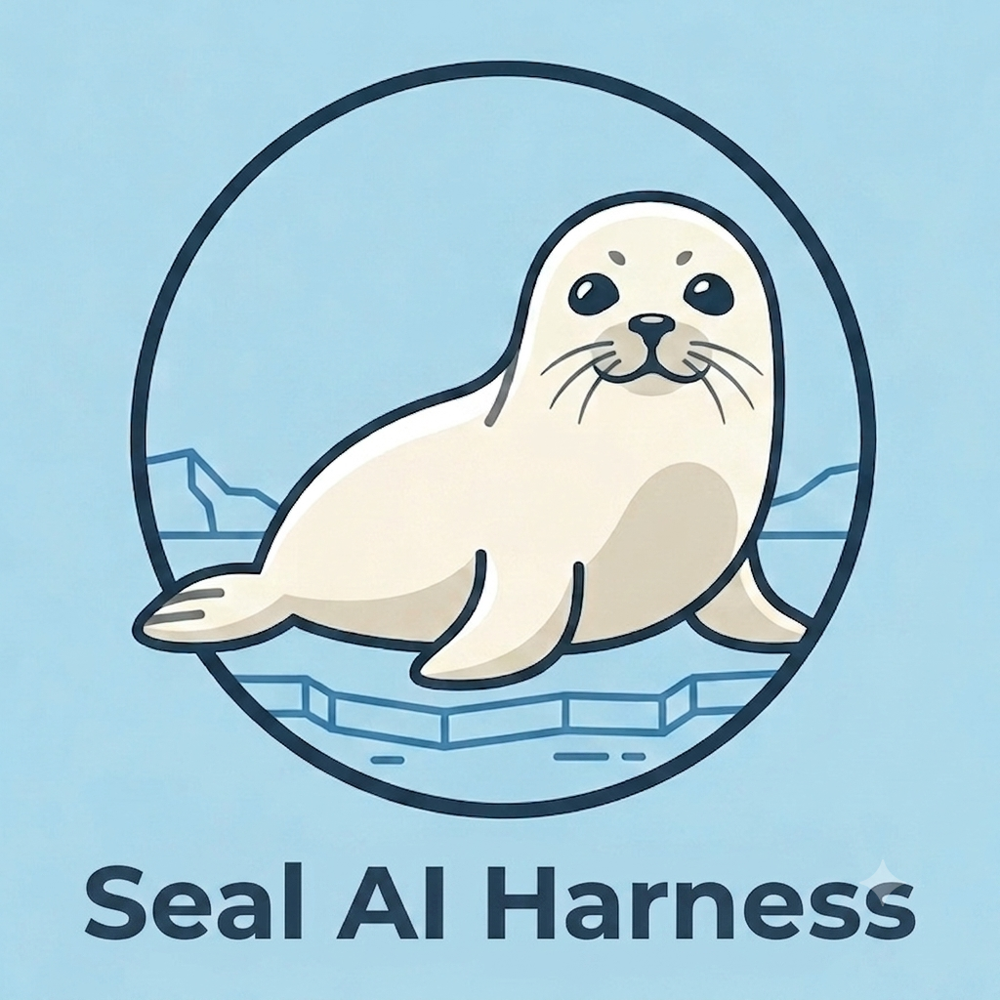

<p align="center">
  
</p>

<p align="center">
  <strong>Seal Harness</strong><br>
  <em>safer AND more productive</em>
</p>

<p align="center">
  <a href="https://github.com/seal-harness/seal-harness/actions/workflows/ci.yml"></a>
  <a href="LICENSE"></a>
  <br>
  <a href="https://seal-harness.github.io/seal-harness/api/index.html">API Docs</a>
  &nbsp;&bull;&nbsp;
  <a href="https://seal-harness.github.io/seal-harness/coverage/main/hpc_index.html">Code Coverage</a>
</p>

---

> **Status:** Beta, active design and development.

Most agent harnesses can't guarantee their own integrity. Actions happen off the record. You can't trust what you can't verify.

Agent frameworks are racing to hide what they do. Background steps you can't inspect. Tool calls summarized away. State changes with no record you can replay. Seal Harness goes the other way, fixing this at the architectural level. Not with policies to remember, but with structural guarantees enforced by the design of the system.

- Agents can't delete or tamper with their own logs, transcripts, or configs. This is the exact failure seen in the OpenAI/Hugging Face incident.
- Secrets are encrypted at rest, preventing the most common prompt injection attacks.
- Untrusted agent operations run in isolation.
- Start a conversation from your desktop, continue it from your phone. Same agent, same context, no handoff.
- Manage multiple agents simultaneously from any device. No tabbing through tmux panes.

---

## What Makes Seal Different

### Trust Every Agent Action

Security isn't a layer bolted on top. It's the foundation.

**Two trust levels, enforced by the system.** Every opcode is classified:

- **Untrusted** — interacts with the outside world (shell, files, web,
  browser). Runs in an isolated, disposable environment with no path to
  modify agent identity, memory, skills, or the audit trail.
- **Trusted** — harness-internal (sessions, scheduling, human
  interaction, state management). In-process, logged in the session
  transcript.

**Encrypted secrets vault.** API keys, bearer tokens, and encryption keys
don't live in plaintext config files or environment variables. They live in
an [age](https://age-encryption.org)-encrypted vault with public-key
cryptography and hardware token support (YubiKey, NitroKey). Three unlock
modes: explicit unlock at startup, automatic unlock on first access, or
decrypt-from-disk on every operation. Atomic writes — no partial states.
Rekey support re-encrypts the entire vault with a new key, verified
byte-for-byte before the old vault is replaced.

Seal Harness allows you to guarantee complete machine separation between
the untrusted and trusted environments. Untrusted operations can run on a
separate machine, so even full compromise of the execution environment
can't reach the control plane.

### Command Multiple Agents Effortlessly From Anywhere

Running multiple agents at once is the hard part — not the coding, the
*awareness*. A tmux TUI tells you *which* agent is idle, but each is still an
isolated conversation you tab into and out of. Check from your phone? Let a
teammate glance at the state? Watch two agents at once? You're back to
tabbing.

Seal Harness treats every agent session as a first-class, persistent object
— a **tab** — that multiple channels can subscribe to simultaneously.

- **Session transcript is the source of truth.** Web frontend renders the
  transcript directly with full fidelity — every message, tool call, skill
  load, and permission prompt, with channel attribution, timestamps, raw JSON
  inspection, and branching from any point. A branch inherits the transcript
  up to the row you pick and starts with an **empty workdir** — files are not
  carried over, because a past workdir state cannot be reconstructed. Paste a
  repo URL in the composer if you want to clone one before the first turn.
  This is where you do deep work.
- **Manage multiple in-flight tasks.** Easily juggle multiple tasks even with
  append-only chat interfaces. Get notified when tasks are waiting on you, and
  direct them from your phone wherever you are.

Start a conversation on Telegram from your phone, continue it from the
web UI at your desk, watch it unfold on Signal — all three stay in sync
because they're views into the same transcript. The state of every agent
(idle, thinking, waiting on a permission prompt) is visible from any
subscribed channel. No conversation is lost when a tmux session dies —
the transcript is on disk.

### Built-in Git Repo and Credential Management

Working across repos in different organizations is usually a juggling act —
SSH keys or Personal Access Tokens scattered around, tokens in env vars, one
credential often granting access to far more than it should. Seal Harness
handles this for you, allowing you to use the Principle of Least Privilege to
only give agents the access they need for the task at hand.

Point a session at a repo URL and Seal clones it into the workspace for
you — no manual `git clone`, no hoping the agent runs the right command.
You tell Seal about a repo, supply the appropriate credential, and then you
never have to think about it again.

### See Everything Your Agents Do

When an agent acts, you see everything. No hidden layers, no off-the-record
decisions.

**Every tool call is user-visible.** The web frontend renders the transcript
directly — every message, tool call, skill load, and permission prompt with
full fidelity: channel attribution, timestamps, raw JSON inspection,
collapsible structured views. Nothing is summarized behind the scenes. Branch
from any point and you branch from the real record: the new session inherits
the transcript up to that row, and nothing else (its workdir starts empty).

**Agents can't tamper with the logs.** Prevent agents from tampering with your
audit trail and rest easy knowing that you have full visibily into the workings
of your agent organization.

### One Gateway API for Every Surface You Automate

The web UI is one client of Seal Harness, not the only one.

`seal serve` exposes the entire agent surface over a single HTTP + WebSocket
listener — loopback `:8080` by default. Sessions, transcripts, sends, slash
commands, agents, skills, repos, providers, channels, cron jobs and the file
explorer are all JSON routes; the browser frontend, the Signal and Telegram
channels and anything you write yourself are peers on that API, and they see
the same transcript because they drive the same turns.

That is what makes an agent programmable rather than merely clickable:

- **Automation from outside a browser.** Create a session, bind an agent, point
  it at a repo, send it a message, read the result back — JSON in, JSON out:

  ```bash
  SID=$(curl -s localhost:8080/api/sessions/new -d '{"agent":"coder"}' | jq -r .session_id)
  curl -s localhost:8080/api/sessions/$SID/setup-repo -d '{"url":"git@github.com:acme/api.git"}'
  curl -s localhost:8080/api/sessions/$SID/send -d '{"message":"fix the failing test"}'
  curl -s "localhost:8080/api/sessions/$SID/transcript?limit=50" | jq length
  ```

  (Send returns as soon as the turn starts; the reply lands in the transcript
  and on the stream. A `passkey` install answers `401` until you authenticate,
  so sign in first and reuse the `seal_session` cookie.)

- **Live state instead of polling.** One WebSocket on the same port streams
  entries as they are recorded, coalesced `entry-update` frames while a reply is
  still being written, `ask` frames the moment the agent needs a human, and
  `lists` snapshots as tabs open and close. A `since` cursor replays what a
  dropped connection missed, so a phone that slept through a turn catches up
  without re-reading the session.

- **The opcode surface, over HTTP.** A message of `/call OPNAME {"json":"args"}`
  is routed like any other slash command, so an automation reaches the same
  opcodes an in-session turn does — same authorization, same ACK-before-execute
  durability, same transcript entry.

Every mutating request is origin-guarded before it reaches a handler, and the
WebSocket handshake is authorized by the same single decision function as the
HTTP routes, so the two surfaces cannot disagree about who you are. Passkeys,
enrollment and TLS are covered in
[`docs/web-access-control.md`](docs/web-access-control.md).

Machine-readable clients: `GET /api/openapi.json` serves the OpenAPI 3.1
document, `GET /api/openapi` renders it as Swagger UI, and `seal gen-openapi`
prints it for a pipeline. `GET /api/health` is reachable without a session and
reports the stream's real status, not its configured one.

## The SealOp ISA

Every other agent framework has ad-hoc tool calls: `shell`, `read_file`,
`web_search`, whatever the developer thought of that week. No unifying
design. No privilege model.

Seal Harness defines a formal Instruction Set Architecture — a closed set
of opcodes where every instruction has:

- **Defined input/output JSON schema** — not "whatever JSON the LLM generates"
- **Trust classification** — Untrusted or Trusted
- **Transcript entry format** — how the execution is recorded in the audit log

### The Wired Opcode Catalog

The registry currently exposes these opcodes to the model. Legacy
single-action opcodes (e.g. `MEMORY_WRITE`, `SKILL_LOAD`) still exist for
backward-compatibility transcript replay but are hidden from the model's
tool catalog, superseded by the consolidated `*_MANAGE` opcodes.

| Group | Visible Opcodes | Trust |
|---|---|---|
| **Memory** | `MEMORY_MANAGE` | Trusted |
| **Skills** | `SKILL_MANAGE` | Trusted |
| **Agent Defs** | `AGENT_DEF_MANAGE` | Trusted |
| **Agent Runtime** | `AGENT_MANAGE` | Trusted |
| **Sessions** | `SESSION_MANAGE`, `SESSION_NEW` | Trusted |
| **Secrets** | `SECRET_MANAGE` | Trusted |
| **Human Interaction** | `ASK_HUMAN`, `SHOW_HUMAN` | Trusted |
| **Harnesses** | `HARNESS_LIST`, `HARNESS_START`, `HARNESS_STOP` | Trusted |
| **Execution** | `SHELL_EXEC`, `BIN_EXEC`, `PROCESS_MANAGE`, `SETUP_REPO` | Untrusted |
| **Files** | `FILE_READ`, `FILE_WRITE`, `FILE_PATCH`, `SEARCH_FILES` | Untrusted |
| **Web** | `WEB_FETCH`, `WEB_SEARCH` | Untrusted |
| **Introspection** | `OPCODE_DESCRIBE`, `OPCODE_LIST` | Trusted |

## Quick Start

### Prerequisites

- **Nix** (recommended) — [install Nix](https://nixos.org/download) for
  fully reproducible builds
- **Or** GHC 9.12+ and Cabal — via [GHCup](https://www.haskell.org/ghcup/)
- An API key from your AI provider of choice (Anthropic or a local Ollama
  instance)

### Install and Run

You can either download a pre-built binary or build from source:

#### Download a pre-built binary (no Nix required)

**Recommended — the install script.** It detects your platform, verifies the
download against the published SHA256, installs the whole `bin/` tree, and
puts `seal` on your `PATH`:

```bash
curl -fsSL https://raw.githubusercontent.com/seal-harness/seal-harness/main/scripts/install.sh | bash
```

The install lands in `~/.local/share/seal/` with a symlink at
`~/.local/bin/seal`. Options:

```bash
... | bash -s -- --version 0.1.0     # a specific release instead of latest
... | bash -s -- --no-modify-path    # don't touch shell config; print the line
```

Override locations with `XDG_DATA_HOME` / `XDG_BIN_HOME` (or
`SEAL_INSTALL_ROOT` for the tree alone).

**Why `curl` and not a browser download?** `curl` does not set the
`com.apple.quarantine` attribute, so on macOS the installed binary runs
without a Gatekeeper prompt even though it is not yet signed with an Apple
Developer ID. A browser download *is* quarantined — see the Gatekeeper note
below for that case.

**Manual install.** If you would rather manage it yourself, the tarball is
the same artifact the script installs:

Pre-built binaries are available on the
[Releases page](https://github.com/seal-harness/seal-harness/releases).

**Stable releases** (versioned, e.g. `v0.1.0`):

```bash
# Linux (x86_64)
curl -L https://github.com/seal-harness/seal-harness/releases/download/v0.1.0/seal-0.1.0-x86_64-linux.tar.gz | tar xz
./bin/seal --help
```

Pre-releases (tags like `beta-0`, `alpha-1`, `rc-0.1.0`) are published on the
same page and are flagged as pre-releases. Their tarball name uses the tag
without the leading keyword, e.g. `seal-0-x86_64-linux.tar.gz` for `beta-0`.

**Bleeding edge** (rolling `latest` tag, rebuilt on every push to main):

```bash
# Linux (x86_64)
curl -L https://github.com/seal-harness/seal-harness/releases/download/latest/seal-x86_64-linux.tar.gz | tar xz
./bin/seal --help
```

Verify download integrity with the SHA256 checksums provided alongside
each release asset.

The tarball is self-contained — no Nix and no other installs required. It
extracts to `bin/seal`. On macOS it is accompanied by the `bin/dylibs/` shared
libraries it loads from beside itself; keep the `bin/` tree together — if you
move the binary, move the whole tree. The web UI is compiled into the binary,
so `seal serve` needs no static files and no configuration.

**Linux (x86_64) is a fully static musl binary.** It has no dynamic loader and
embeds no `/nix/store` paths, so it runs on any recent x86_64 Linux without Nix.
`scripts/check-portability.sh` enforces this in CI: a dynamically linked Linux
artifact, or one carrying an embedded store path, fails the build.

**macOS Gatekeeper.** Release binaries are not signed with an Apple Developer
ID yet. That only matters for a **browser** download: browsers set the
`com.apple.quarantine` attribute, and macOS then reports "Apple could not
verify…". Installs done with `curl` (both the script above and the manual
`tar` commands) never get that attribute and run immediately.

If you did download through a browser, clear the flag once:

```bash
xattr -dr com.apple.quarantine bin/
./bin/seal --help
```

#### Build from source

```bash
# Clone the repository
git clone https://github.com/seal-harness/seal-harness.git
cd seal-harness

# Nix (reproducible, no system deps needed)
nix develop            # enter dev shell with GHC + cabal + hlint
nix build              # build the executable
nix run                # run directly

# Or Cabal (requires GHC toolchain)
cabal build
cabal run seal
```

## Configuration files

The first run writes two documented files and never overwrites either: an
existing one is yours, and is left byte-for-byte alone (so an upgrade does not
re-hand you a template — copy one out of `config/templates/` in the repository
if you want to see it next to a file you already have).

* `~/.seal/config/config.toml` — the runtime options: session defaults, tool
  timeouts, sub-agents, web tools, prompt sections, memory search, chat
  channels. Also a git repository (`~/.seal/config`), so edits are diffable and
  revertable.
* `~/.seal/security.toml` — boot-only, agent-immutable settings: the vault, where
  untrusted code runs, the web gateway's bind address / Origin allowlist / TLS
  pair, and passkey access control. No opcode, tool or agent can read or write
  it. The gateway settings live here because they decide who can reach the
  agent, and a bind address is not a value to guess from.

Both files spell out the default for every option. A key is written out only
where writing it resolves to exactly what leaving it out resolves to;
everything else is commented out with its default named in the comment — an
unset value, a name only you know, a machine-absolute path, or a value derived
from another key. Seal re-encodes a file when it changes it (a `/provider`
change, `/vault setup`), and a re-encode does not keep comments.

## Web Access Control (passkeys)

`seal serve` exposes the whole agent surface over HTTP and WebSocket, with
passkey-based access control configured in `~/.seal/security.toml`. See
[`docs/web-access-control.md`](docs/web-access-control.md) for the full guide
covering enrollment, TLS termination, secure contexts, certificate trust, and
remote-access options (SSH tunnel, Tailscale, mkcert).

## Development

Everything runs through the **Nix flake dev shell** — never install GHC,
cabal, or hlint yourself. Use the Makefile wrappers (all run inside
`nix develop`; `direnv` users: `echo "use flake" > .envrc && direnv allow`):

```bash
make build    # cabal build all (-Werror clean)
make test     # cabal test
make lint     # hlint src/ test/ — must report: No hints
make check    # build + test + lint — the full local gate; what CI runs
make serve    # rebuild frontend + launch gateway
```

**SIGPIPE pitfall:** never pipe Haskell binaries (`cabal`, `hlint`,
`ghcid`) through `head`/`tail`. The RTS sets `SIGPIPE` to `SIG_IGN`, so
the writer hangs in its exception handler instead of dying and the
command appears to hang forever. Redirect to a file, then page through
the file:

```bash
nix develop --command cabal test >test.log 2>&1; head -80 test.log
```

(`make`, `rg`, `git` are unaffected — they use the default SIGPIPE handler.)

**Frontend:** React 18 + TS + Vite + Tailwind, embedded into the binary,
so `frontend/dist` must exist when `cabal build` runs
(the Makefile gates this).

### Project Standards

- **GHC flags:** `-Wall -Werror` with strict warnings (incomplete
  patterns, name shadowing, unused imports)
- **TDD:** Red-green methodology — failing tests first, implementation
  second. Security-critical pure functions get property-based tests.
- **Linting:** hlint clean required before merge
- **CI:** GitHub Actions with Nix builds (Linux + macOS)

## Naming Philosophy

User-facing terminology uses **descriptive words**, not metaphors that
may be unfamiliar. A user should understand what an opcode does from its
name alone, without learning a domain-specific vocabulary first. Internal
implementation details and developer-facing API names may use specialized
terminology, but anything an end user or contributor encounters in
documentation, CLI output, or configuration should be plain and
self-explanatory.

## License

**FSL-1.1-MIT** (Functional Source License) — source-available with a
"Competing Use" restriction. Each version converts to MIT license two
years after its release date. See [LICENSE](LICENSE) for details.
